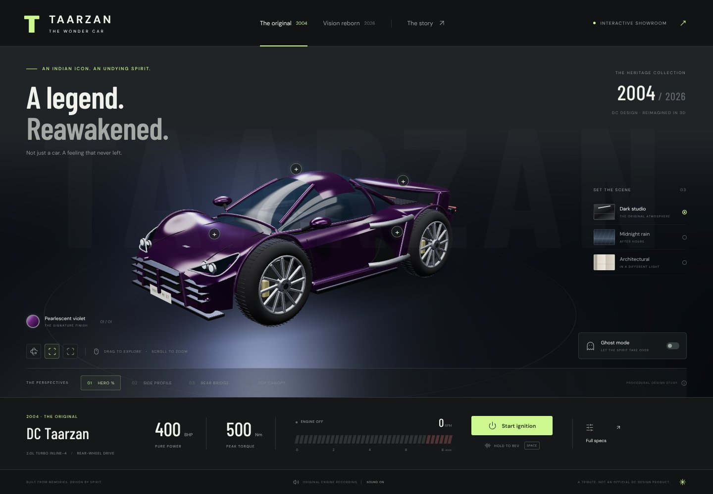

# Vehicle Visualization Research

### Interactive 3D representations for advanced automotive education

**Research prototype · Browser-based demonstration · Analytical teaching models**

This project investigates how interactive vehicle rendering can support teachers in explaining automotive systems to advanced students. The **Taarzan interactive showroom** is the visual demonstrator: an enclosed procedural coupe with inspectable body features, camera views, drivetrain concept comparisons, and authentic source audio.

The repository separates **visual representation**, **analytical models**, and **educational evidence**. A convincing render is not proof of engineering accuracy or improved learning. No classroom study, CFD analysis, structural validation, or factory-specification verification has been completed.

## Start here

| Audience        | Entry point                                                                                            |
| --------------- | ------------------------------------------------------------------------------------------------------ |
| Teachers        | [Teaching guide and lesson sequence](docs/teaching/TEACHING_GUIDE.md)                                  |
| Students        | [Engineering exercises and worked example](docs/teaching/EXERCISES.md)                                 |
| Researchers     | [Research questions and study protocol](docs/research/RESEARCH_FRAMEWORK.md)                           |
| Engineers       | [Architecture](docs/engineering/ARCHITECTURE.md) and [model validity](docs/research/MODEL_VALIDITY.md) |
| Contributors    | [Contribution guide](CONTRIBUTING.md) and [roadmap](docs/research/ROADMAP.md)                          |
| Asset reviewers | [Provenance](docs/assets/PROVENANCE.md) and [machine-readable manifest](docs/assets/manifest.json)     |

## Demonstration



_Procedural reconstruction, not scanned geometry or a validated digital twin. Screenshot generated from the demonstration application; no engineering measurement is implied._

- Closed violet coupe, interior, wheel assemblies, silver intake guides, and bridge spoiler.
- Heritage and fictional hybrid concept variants; three lighting environments.
- Orbit controls, four camera presets, accessible hotspots, specifications and source gallery.
- Original engine recording, ignition gesture, pitch-based throttle interaction and RPM display.
- Ghost mode, rain, lighting and autonomous steering effects demonstrate interaction design, not vehicle autonomy.
- Responsive rendering with a lighter mobile/software-GPU path.

**Current educational scope:** teachers can use the render to discuss visible geometry and packaging. Engine internals, gearbox kinematics, load-bearing chassis, flow fields and quantitative telemetry are **not** modeled in the showroom. Independent SI-unit teaching functions provide introductory calculations; they are not coupled to the rendered car.

## Quick start

Requires **Node.js 22.12+** and npm. Browser rendering requires WebGL2.

```sh
npm ci
npm run dev -- --port 5173
```

Open the displayed URL. Start ignition, then hold **Space** or the pedal to rev. Drag to orbit; scroll to zoom. Audio needs a user gesture. Teachers should lower the volume before starting class.

```sh
npm run examples       # hypothetical worked engineering calculations
npm test               # analytical model unit tests
npm run verify:assets  # local source/derivative integrity
npm run check          # formatting, asset checks, unit tests, production build
npm run test:smoke     # browser checks; development server must be running
```

The test browser is bundled for Linux x64. Other platforms require `npx playwright install chromium`. Use `TEST_URL` to override the browser test URL. Use `ASSET_BASE_URL` with `npm run verify:assets` to check HTTP responses and served hashes.

```sh
npm run build
npm run preview -- --port 5173
```

Deploy `apps/showcase/dist/` to a static host at its root. Assets and fonts are local; no backend or external media host is required.

## Repository structure

```text
apps/showcase/             Visual research demonstrator
  src/scene/              Procedural vehicle construction and materials
  src/styles/             Responsive presentation
  public/references/      Source photographs
  public/audio/           Original and compatible engine recording
  public/video/           Source reference clip
packages/vehicle-science/  Independent, documented SI-unit teaching functions
docs/research/            Questions, validity boundaries, evaluation, roadmap
docs/teaching/            Lesson plans, exercises, assessment rubric
docs/engineering/         Architecture and demonstrator documentation
docs/assets/              Provenance and integrity manifest
docs/media/               Selected showcase evidence, not generated build output
scripts/                  Asset verification and worked examples
tests/unit/               Equation, invariant and input-validation tests
tests/e2e/                Browser rendering and interaction smoke tests
.github/                  CI, issue forms and review checklist
```

## Research scope

The target audience is advanced secondary, undergraduate and technical-education students with basic mechanics and algebra; calculus is useful for extension work. Topics span engine power, torque transmission, bodywork and packaging, chassis load paths, aerodynamics, braking and hybrid power accounting.

The methodology is **representation → guided observation → explicit analytical model → sensitivity analysis → critique of assumptions**. Planned studies compare interactive instruction with matched static diagrams. See the [framework](docs/research/RESEARCH_FRAMEWORK.md) for hypotheses, participant safeguards and a reproducible protocol.

### Evidence status

| Claim                                                               | Status                                    |
| ------------------------------------------------------------------- | ----------------------------------------- |
| A procedural coupe can be rendered and interacted with in a browser | Implemented; browser smoke tests          |
| Source assets are preserved and traceable                           | Hash-verified manifest                    |
| Introductory SI equations obey their documented invariants          | Unit-tested analytical functions          |
| The model matches actual vehicle dimensions or component internals  | Not established                           |
| Aerodynamic/structural/thermal performance is simulated             | Not implemented                           |
| Student understanding improves                                      | Hypothesis; no participant data collected |

See [evaluation](docs/research/EVALUATION.md) for evidence tiers and reporting requirements. Test success does not establish physical validity or pedagogical effectiveness.

## Attribution and use

This is an independent research-oriented fan demonstrator, not an official DC Design or film product. Heritage figures reproduce the supplied design brief and are not independently verified. The 2026 hybrid and its performance targets are fictional. Component peak powers must not simply be added.

Source photographs, video and audio were supplied through the repository. No media redistribution rights or open-source license are assumed. See [rights and attribution](docs/assets/RIGHTS.md). Cite the project using [CITATION.cff](CITATION.cff); attribution does not grant reuse permission.
